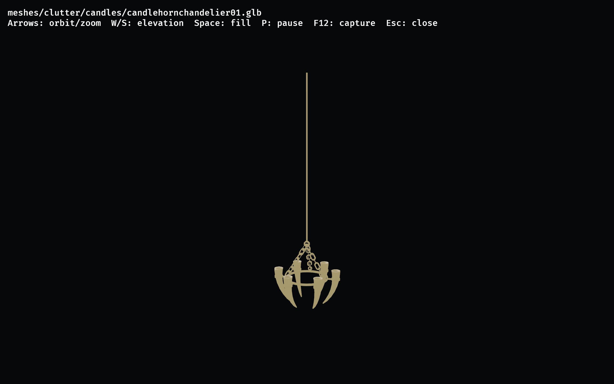
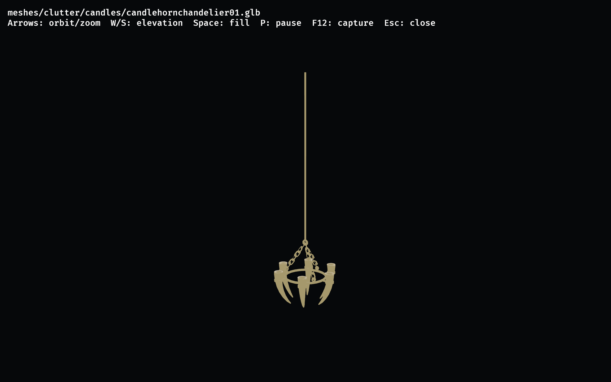
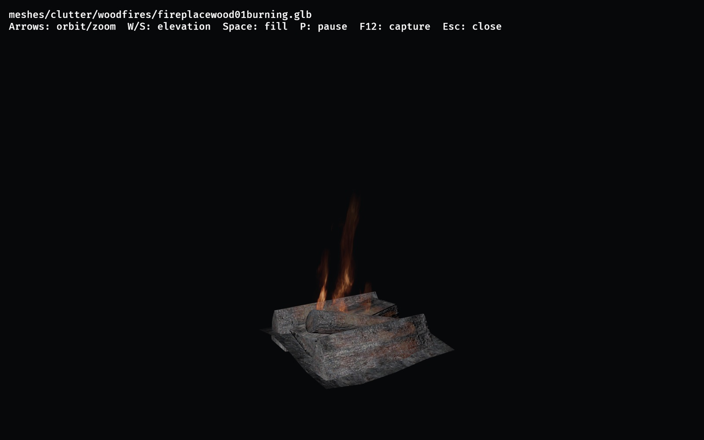

# Model inspector

Open converted models in a visible macOS/Metal window without starting a world:

```sh
python3 -B scripts/inspect-model.py --assets /absolute/converted/assets --model meshes/clutter/example.glb
```

The command builds the `model_inspector` example through the existing managed workspace wrapper,
then keeps its lease and watchdog active until the window and owned children close. It never
creates a worktree-local `target/`, converts assets, writes into the asset directory, or launches
another inspector over an occupied native lane.

## Setup and inputs

Use Python 3.9+, the repository Rust toolchain, macOS/Metal, and your own converted assets.
The repository's managed storage bootstrap must already be installed. The launcher uses
`scripts/workspace.py` when available, otherwise `bin/workspace.py` under shared storage
(`.mudcrab-local` beside the common Git directory). An existing `MUDCRAB_WORKSPACE_ROOT` selects
the configured storage root. If the wrapper is missing, the command refuses before building.
This tool does not install or replace the shared bootstrap.

Pass a lowercase, root-relative `.glb` or `.gltf` path. Model paths must stay inside `--assets`.
Use `--record 00035F4A` instead to resolve a **hexadecimal base FormID** through the catalog's
`statics` table. The default catalog is `skyrim_world.db` under `--assets`; `--catalog /absolute/catalog.db`
selects another read-only catalog. Repeat `--model` or `--record` to compare up to eight models
side by side. Models retain their authored scale; comparisons at very different scales may need
separate sessions.

Record lookup displays a model, not a complete placed reference or actor. A record with rows in
`base_texture_swaps` is refused rather than shown with a misleading default material. Pending
per-record material, NIF UV-playback, and animal-idle features are not adopted by this tool PR.
The richer all-pending inspection copy and its retained playtest builds remain separate.

## Controls

| Key | Action |
| --- | --- |
| Left/right arrows | Orbit |
| Up/down arrows | Zoom |
| W/S | Raise/lower the camera angle |
| Space | Toggle ambient fill |
| P | Pause/resume application time; camera controls remain active |
| F12 | Save a screenshot |
| Esc | Close the session |

The viewer frames loaded mesh bounds, reports `INSPECTOR_READY`, and requests two automatic
captures after framing. Readiness means assets loaded and bounds were found; it is not a GPU
qualification. Early captures can precede shader readiness. The standalone main-based build does
not install the pending authored NIF UV or creature-idle playback consumers, so P does not add
animation to a static model.

## Screenshots

These F12 captures use this tool's main-based build on Apple M4 Pro/Metal. They show
baseline model viewing, not acceptance of pending material fixes. The chandelier's
flat baseline material is visible; #483 is not part of this tool PR.



Single-model view. Use the up/down arrows to fit the model, then F12 to save the frame.



Orbit view with ambient fill toggled off. Left/right arrows orbit; Space toggles fill.
The baseline emissive surface changes little with ambient fill. There is no wireframe mode.

## Limits, output, and recovery

Only one native session runs at a time. A busy native lock, another game/inspector, another managed
build at native intake, elevated host pressure, or a failed observation causes refusal. Leave peer
work untouched. Storage limits come from the installed workspace wrapper and its configured
budgets; the launcher does not lower them. It also checks the global two-command ceiling while
holding the wrapper's allocation lock.

The watchdog enforces sampled whole-family limits: 4 GiB RSS and 6 GiB physical footprint for the
viewer; 8 GiB for a build; 32 MiB of logs per phase. Host gates require normal pressure and a
free-plus-inactive headroom estimate of 12 GiB before native startup and 8 GiB while running,
with a 1 GiB swap-growth stop. These estimates and samples are not allocator, driver, or arbitrary
detached-process guarantees. Build host gates use 4/2 GiB headroom and a 256 MiB swap-growth stop.
The viewer closes after 30 minutes; loading must finish within 90 seconds. Builds have a one-hour
watchdog. No failed phase is retried automatically.

Each launch creates a new directory under shared `evidence/model-inspector/run-*`. It retains the
build/native logs, sampled telemetry, binary path/hash, readiness, screenshots, and release
receipts. The binary stays in the managed cache while its lease is held. The launcher forwards
interrupts to its birth-checked worker, lets that worker clean up, then releases the build lease.
If owned cleanup cannot finish, it holds the lease for inspection rather than clearing it.
Do not delete retained evidence or someone else's lease to make a retry pass.

Use `--build-only` for a managed build without native startup. `--isolated LABEL` selects an
isolated validation cache; ordinary interactive runs use the shared wrapper slots. `--needed-gib N`
sets the build-growth estimate, not a quota or a cap increase.

## Checks and evidence boundaries

```sh
python3 -B -m unittest discover -s scripts/tests -p test_inspect_model.py -v
```

Through the managed wrapper, run the example tests and strict example Clippy:

```text
cargo test --locked --profile quick -p engine --example model_inspector
cargo clippy --locked --profile quick -p engine --example model_inspector -- -D warnings
```

Python tests use mocks for monitoring and cancellation; they do not launch a renderer. Rust tests
cover path/record boundaries with temporary procedural inputs. Neither proves GPU behavior,
Skyrim visual parity, world/resource admission, performance, all-animal coverage, or acceptance
of other PRs. Earlier all-pending goat/fireplace/red-blue playtests covered different source;
they are provenance for this extraction, not native proof of this clean-main branch.

The following F12 frames show the same fireplace and camera with ambient fill on and off.
They are static baseline frames. They do not accept the pending #484 UV animation work.
The capture run used temporary logging-only diagnostics, which were removed after evidence capture.
The goat-horn chandelier remains the #483 baseline; this tool PR does not adopt its pending material fixes.



Fireplace frame with Space fill on.


Same camera frame with Space fill off.
